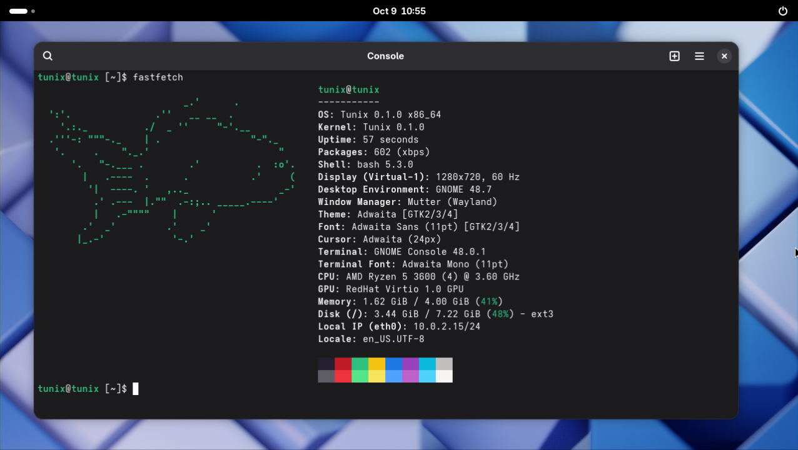

# Tunix

[](https://github.com/tuna4ll/tunix/actions/workflows/ci.yml)



A Unix-like kernel for x86_64 and aarch64 that runs an unmodified Void Linux userland.

## Build, Configure and run

```sh
make menuconfig # Configure your kernel before compiling.
make        # kernel and disk image
make run    # boot it in QEMU
make test   # run the kernel tests
make ext4-test  # write ext4 filesystems and check them with e2fsck
make rust-test  # unit and differential tests of the Rust code
```

The desktop is Weston by default. `make DESKTOP=gnome` builds a GNOME image
instead, and `make DESKTOP=kde` a KDE Plasma one with the SDDM login screen.

`make -C kernel` builds only the kernel and its modules, into `kernel/build/`.

Log in as `root` with the password `tunix`.

## Layout

```
kernel/       the kernel, with its own GNUmakefile, subprojects/ and rust/
base-files/   files added to the Void userland
boot/         Limine boot menus for x86_64 and aarch64
tools/        image and sysroot builders, hardware report
testsuites/   kernel boot tests, the ext4 and ACPI tests and a C++ POSIX suite
utils/        small programs for Tunix images, such as the CI boot init
ci/           the scripts CI runs, each one runnable locally
docs/         kernel documentation
```

## License

MIT
